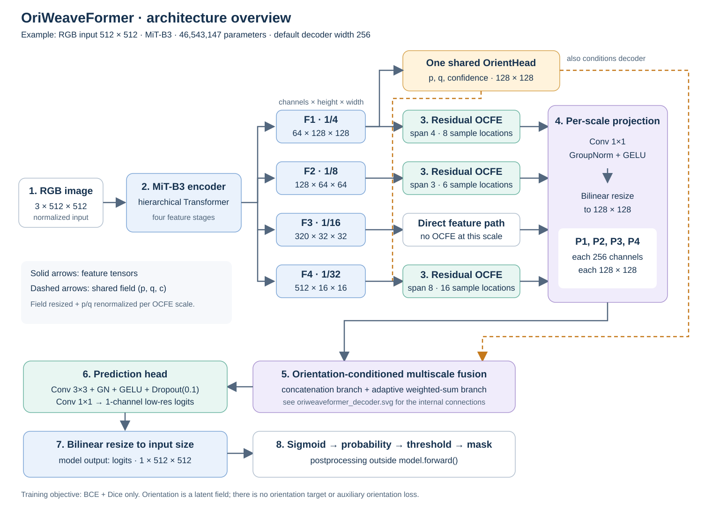
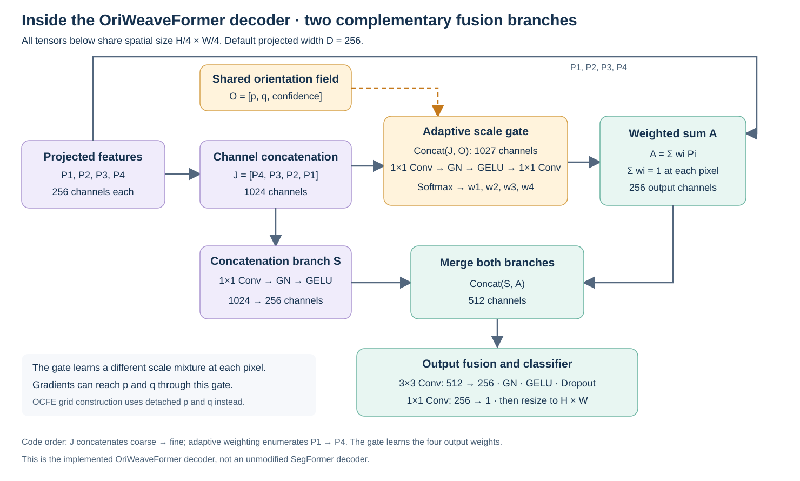

# OriWeaveFormer: đọc sơ đồ và hiểu từng bước xử lý

Sơ đồ được đối chiếu với `src/oriweaveformer/model.py`. Các kích thước dưới đây dùng ảnh RGB 512 × 512 và cấu hình mặc định MiT-B3, decoder_dim=256. Không tính chiều batch khi ghi kích thước. Tổng số tham số được kiểm tra bằng cách khởi tạo model: **46.543.147**.

## 1. Ảnh đầu vào

Ảnh được chuẩn hóa theo mean/std ImageNet ở pipeline dữ liệu, rồi đưa vào mạng dưới dạng tensor `B × 3 × H × W`. Crop và augmentation là xử lý dữ liệu bên ngoài model. Với crop 512, model nhận `B × 3 × 512 × 512`.

Mục tiêu cuối cùng là gán cho từng pixel một xác suất thuộc lớp đường. Mạng chưa tạo đồ thị đường, các nút giao hay danh sách tuyến đường.

## 2. MiT-B3 trích xuất bốn mức đặc trưng

Encoder là một Transformer phân cấp. Các giai đoạn được tính nối tiếp bên trong encoder; sơ đồ thể hiện bốn đầu ra được lấy ra từ quá trình đó.

| Đặc trưng | Tỉ lệ | Kênh × cao × rộng với ảnh 512 |
|---|---|---|
| F1 | 1/4 | 64 × 128 × 128 |
| F2 | 1/8 | 128 × 64 × 64 |
| F3 | 1/16 | 320 × 32 × 32 |
| F4 | 1/32 | 512 × 16 × 16 |

Có thể hình dung đây là bốn cách quan sát cùng một ảnh: mức có độ phân giải cao giữ chi tiết vị trí tốt hơn, còn mức sâu hơn biểu diễn ngữ cảnh tổng hợp. Đây là vai trò dự kiến của tháp đặc trưng; không phải mỗi mức chỉ nhận diện một loại đường cố định.

## 3. Một OrientHead tạo trường hướng dùng chung

Nhánh này nhận F1 **trước OCFE**, qua hai lớp Conv 3×3 + BatchNorm + GELU và một Conv 1×1. Nó trả về ba bản đồ: `p`, `q`, `c`.

- `p, q` được chuẩn hóa và được diễn giải bằng biểu diễn góc nhân đôi: `p ≈ cos(2θ), q ≈ sin(2θ)`.
- Khi xây dựng lưới lấy mẫu, code tính `θ = 0.5 × atan2(q, p)`.
- `c = sigmoid(confidence_logit)` nằm trong (0,1), được dùng làm hệ số điều tiết nhánh bổ sung đặc trưng. Đây không phải xác suất độ tin cậy đã được hiệu chuẩn bằng nhãn.

Hướng dọc một con đường không cần phân biệt đi xuôi hay đi ngược; biểu diễn góc nhân đôi phù hợp với tính chất này. Tuy nhiên, OriWeaveFormer học trường này gián tiếp bằng loss phân đoạn. Không có nhãn góc để bảo đảm p/q chính xác là tiếp tuyến đường tại mọi pixel.

**Chỉ có một OrientHead. Ba khối OCFE không có nghĩa là ba orientation head hoặc ba hướng tại một junction.**

## 4. Ba ResidualOCFE bổ sung ngữ cảnh

Các khối được đặt ở F1, F2 và F4. F3 đi thẳng tới decoder. Trường p/q/c được resize theo từng mức; p/q được chuẩn hóa lại trước khi sử dụng.

| Đầu vào OCFE | span | Số vị trí lấy mẫu theo hai phía |
|---|---|---|
| F1 | 4 | 8 |
| F2 | 3 | 6 |
| F4 | 8 | 16 |

`span` là số mức khoảng cách mỗi phía của **một hướng**, không phải số hướng dự đoán. Code dùng `grid_sample` lấy đặc trưng ở các vị trí lệch theo hướng đó, rồi `reshape → mean` để tạo tensor ngữ cảnh C. Tensor này được ghép với đặc trưng gốc và đưa qua hai Conv 1×1, ở giữa có GELU.

Biểu thức tổng hợp đúng theo nhánh residual là:

`F_out = F + sigmoid(scale_logit) × c × fuse(concat(F, C_code))`

Mỗi OCFE có một tham số scale riêng, khởi tạo sao cho sigmoid bằng 0,1. Nhờ vậy, nhánh bổ sung bắt đầu với đóng góp được giảm xuống và vẫn có đường truyền trực tiếp từ F.

**Lưu ý triển khai quan trọng:** đầu ra grid_sample có thứ tự `B × C × (L·H) × W`, nhưng code hiện reshape trực tiếp thành `B × L × C × H × W` trước khi mean theo L. Khi C và L đều lớn hơn 1, đây không tương đương với `reshape(B, C, L, H, W).mean(dim=2)`: cách hiện tại trộn lại thứ tự kênh và vị trí mẫu. Vì vậy không nên mô tả C_code trong paper như một phép lấy trung bình L điểm riêng biệt trên từng kênh. Sơ đồ giữ nguyên đúng phiên bản checkpoint đã học; chưa sửa thao tác này trong lần vẽ sơ đồ.

## 5. Đưa bốn mức về cùng kích thước

Mỗi mức sau bước trên đi qua Conv 1×1 + GroupNorm + GELU, đưa số kênh về 256. Các mức thấp hơn được nội suy bilinear về H/4 × W/4. Kết quả là P1, P2, P3, P4, cùng kích thước `256 × 128 × 128` với ảnh đầu vào 512.

Việc chuẩn hóa số kênh và kích thước giúp decoder ghép hoặc cộng các mức với nhau.

## 6. Decoder kết hợp hai nhánh

Nhánh ghép nối ghép P4, P3, P2, P1 theo chiều kênh thành J có 1024 kênh. Conv 1×1 + GroupNorm + GELU nén J về S có 256 kênh. Nhánh này cho phép mạng học cách kết hợp trực tiếp thông tin của cả bốn mức.

Nhánh chọn tỉ lệ ghép J với `[p,q,c]`, tạo đầu vào 1027 kênh cho scale_gate. Sau Conv 1×1 + GroupNorm + GELU + Conv 1×1, softmax tạo bốn hệ số w1–w4 ở mỗi pixel. Nhánh này tính:

`A = w1 × P1 + w2 × P2 + w3 × P3 + w4 × P4`, với `Σ wi = 1` tại mỗi pixel.

Có thể hình dung mạng tự quyết định cần bao nhiêu chi tiết từ mức nông và bao nhiêu ngữ cảnh từ mức sâu cho từng vị trí. Không có quy tắc đặt sẵn rằng đường nhỏ phải ưu tiên F1 hoặc vùng bóng che phải ưu tiên F4.

Decoder ghép S và A thành 512 kênh. Đây là decoder đã sửa cho OriWeaveFormer, không phải SegFormer decoder nguyên bản.

## 7. Tạo logits ở kích thước ảnh gốc

Tensor 512 kênh qua Conv 3×3 → 256 kênh, GroupNorm, GELU và Dropout2d(0,1). Conv 1×1 đưa về một kênh logits ở H/4 × W/4. Cuối cùng, nội suy bilinear đưa logits về H × W.

`model.forward()` trả về `{"logits": ...}`; đầu ra chưa phải mặt nạ nhị phân.

## 8. Huấn luyện và suy luận sử dụng đầu ra như thế nào?

Khi huấn luyện, `L = BCEWithLogits + soft Dice`, không có clDice hoặc orientation loss. Dice tính trên minibatch của từng process; khi dùng DDP, gradient được lấy trung bình giữa các process. Source đóng gói tính loss bằng FP32 để tránh tràn phép cộng FP16.

Khi suy luận, sigmoid đổi logits thành xác suất. Threshold đổi xác suất thành mặt nạ đường/không đường. Native sliding window và D4 8TTA là pipeline gọi model nhiều lần rồi tổng hợp xác suất, không phải các lớp nằm trong OriWeaveFormer.

Dù p/q bị detach khi tạo lưới OCFE, chúng vẫn nhận gradient qua scale_gate của decoder. Confidence c cũng nhận gradient qua nhánh residual. Vì vậy nhánh hướng vẫn được tối ưu gián tiếp từ loss phân đoạn.

Sơ đồ mô tả cấu trúc đang chạy, không tự chứng minh từng module làm tăng IoU. Muốn xác định đóng góp của từng khối cần thực nghiệm ablation với cùng dữ liệu và pipeline.
